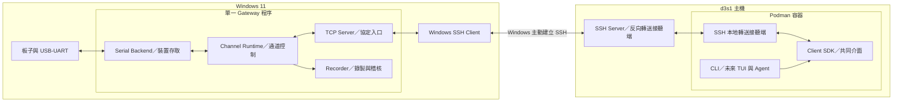
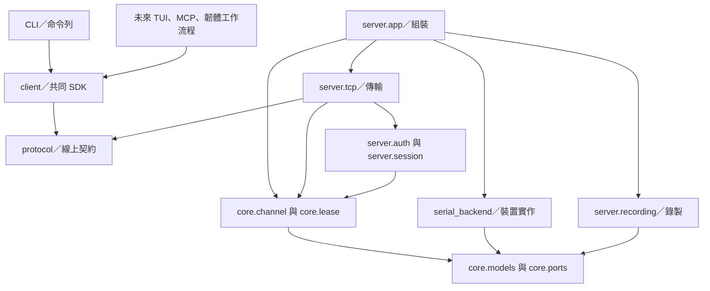
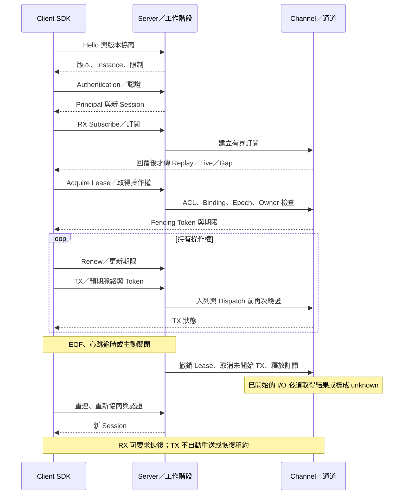
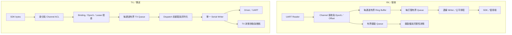

# 系統架構

> 核准更新（2026-11-03）：使用者已在本次對話接受全部建議答案，核准 Phase 0 文件與建議基線。下文「候選／建議／待核准」保留設計來源與理由，現已作為初始採用值；不代表硬體或網路已驗證。Q-11 接線與 UART 參數已由使用者確認；Q-12～Q-14、Q-17 的現場資訊仍待取得。目前實作與驗證進度以專案狀態文件為準。

## 文件狀態與權威範圍

本文件描述 UART Gateway 已核准的架構基線與詳細設計；目前已實作第一批無硬體通路，尚未完整實作全部設計。決策及原審查差異集中於 [專案狀態](status.md)，七份 ADR 均為 Accepted（已正式接受）。線上欄位及 API 的唯一權威來源是 [協定 V1](protocol/v1.md)，本文件不另定一套格式。

已確認方向：單一 Windows Gateway Process（程序）、Core（核心領域邏輯）不依賴具體外部介面、共同 SDK（用戶端開發套件）、多 Channel（邏輯通道）模型、獨占 TX Lease（傳送租約）、有界 Queue（佇列）、明確的換板確認、資料世代與缺口、應用層認證。完整原則亦列於 [協作規則](../AGENTS.md)。

## 系統部署架構

Gateway 與兩端 Forward（轉送）都綁定各自的 Loopback（回送介面）。實際位址、Port（連接埠）與證據見 [部署文件](deployment.md)。不把 Windows 的 COM 操作移到 Linux，也不將 SSH 或 Firmware Workflow（韌體工作流程）放入 Core。

## 軟體模組與依賴

以下名稱對應 [開發規劃](development.md) 的完整 Python 結構；實際完成範圍以 [狀態](status.md) 為準，尚未需要的模組不提前建立。

| 模組 | 責任與輸入／輸出 | 依賴與邊界 |
| --- | --- | --- |
| `core.models` | 通道、Binding（綁定）、事件與狀態資料 | 不依賴 Wire Model（線上資料模型）或 pySerial |
| `core.ports` | 最小 Serial、Clock（時鐘）及事件輸出介面 | 只定義已需要的契約，不建立通用外掛框架 |
| `core.channel` | RX 接收、Ring Buffer（環狀緩衝區）、訂閱、生命週期與 TX 排程 | 使用 Core 模型、介面與 Lease 規則 |
| `core.lease` | Owner（持有者）、期限、Fencing Token（隔離序號）與交接 | 不開啟 Socket（通訊端）或 COM |
| `serial_backend` | 裝置枚舉、開關、設定、讀寫及 I/O 故障回報 | 實作 Core 介面；依賴 pySerial；不知道 Project 或 Session |
| `protocol` | 訊息、編解碼、驗證、錯誤碼 | 不依賴 Server、Client 或 Serial Backend |
| `server.tcp` | Frame（訊框）、連線、Dispatch（派送）與輸出排程 | Protocol、Session 與 Core；不得自行實作 Lease |
| `server.auth` | Principal（認證身分）與 Channel ACL（通道存取規則） | 設定與認證資料；不信任自報的 Client ID |
| `server.session` | 連線所屬身分、訂閱、Heartbeat（心跳）與清理 | 呼叫 Core 釋放資源；不是 RX 必經的轉呼叫層 |
| `server.recording` | 非同步 RX 錄製、分段、容量限制與完整性 | Core 事件與檔案系統；不得阻塞 UART Reader；Audit 尚未實作 |
| `recording_info` | 本機 Capture 的格式／雜湊／位移與收尾檢查 | 只讀檔案，不連線、不操作 UART；不是磁碟 Replay API |
| `recording_text` | 檢查中的紀錄串流轉為 UTF-8 可讀文字 | 共用 recording_info 的有界掃描回呼；不連線 UART，不覆寫來源或既有輸出 |
| `recording_play` | 錄製檔快速回看、邊界提示與取消 | 共用 recording_info／TerminalRenderer；慢終端直接減慢離線掃描，不建立 Gateway 連線 |
| `server.config`、`server.app` | 驗證設定、組裝具體物件、啟停順序 | 組裝層可以知道具體 Backend，不把此依賴帶入 Core |
| `client.transport`、`client.sdk` | 連線、版本、請求配對、訂閱、Lease 更新與重連 | Protocol；不依賴 Server 或 Windows Serial |
| `cli`、未來 `tui`／工具介面 | 參數、顯示、使用者或 Agent 操作 | 只經 SDK 進入 Gateway；不複製協定實作 |
| `text_renderer` | 終端模式的增量控制序列過濾與顏色驗證 | 純文字轉換，不依賴 Serial、Core 或 Server，不修改原始 RX |
| `local_launcher` | 本機只讀啟動、就緒檢查與自己子程序的生命週期 | 建立既有 `server.app` 子程序，UART 操作只經 SDK；端點名稱正規化重用純函式，不直接存取 Serial |
| `local_ports` | 本機裝置顯示、互動選擇與選擇後重驗 | 只用 Backend 的只讀枚舉結果，交回既有 Adapter Selector；不開啟 Serial、不新增遠端 API |
| `local_profile` | 本機通道名稱／裝置條件的驗證、保存及重新解析 | 只讀枚舉、產生既有 TOML 通道欄位；不保存 Token／確認資格、不開啟 Serial |
| `workbench` | 同步本機只讀工作台與錄製選單 | 只傳結構化 argv 給既有 CLI 路由；不使用 Shell，不存取 Serial／Core；清理失敗向外傳遞 |

圖中箭頭是程式依賴方向，不是資料傳送方向。`server/` 與 `gateway/` 合併為同一責任範圍；Session、Recorder 初期各用模組即可，不拆服務。DTO（資料傳輸物件）轉換放在 Server 邊界。

`run-com3.cmd` 是本機薄入口，由 `cli local` 呼叫 `local_launcher` 管理一個 Gateway 子程序，再以同一 SDK 接收資料；CLI 不把 Server／Core 直接當作 UART 操作介面。它只維護自己建立的子程序，不接管既有 Gateway，也不改 API Contract。就緒、程序鎖、臨時認證與 EOF 關閉的設計理由見 [啟動器審查](local-launcher.md)。

兩條模式沿用同一生命週期：先取得全部端點鎖，再建立唯一 Gateway。各 Channel 使用獨立 SDK Session 與原 `watch_client`，共用有界畫面 Writer；不讓兩個監控搶讀同一 SDK 事件佇列。各自維持解碼及顏色狀態，輸出加上來源標記。單條遺失只結束該監控；全部停止、整體程序退出、顯示失敗或 Ctrl+C 才結束整組。新配置只在啟動前載入，不新增 Runtime 設定 API。

## 身分與資料模型

| 概念 | 識別、關係與存續期間 |
| --- | --- |
| Adapter（轉接器） | 實體 USB-UART；VID/PID、Serial Number（序號）、Location（位置）只是識別線索，可能缺失或重複 |
| COM Port | Windows 當下的 Serial Endpoint（序列端點）；可重編號或被重用，不能作永久裝置 ID |
| Channel | 穩定 `channel_id` 對應一個邏輯操作位置；可改接不同 Adapter；同時間至多開啟一個端點 |
| Binding | 當次 Adapter 與板子目標描述、`label`、`target_note`、`binding_revision`、確認狀態；不等於自動識別實體板子 |
| Session（工作階段） | 候選 V1 一條已認證 TCP 連線一個 Session；可訂閱多個 Channel；不跨重連或重啟恢復 |
| Principal | 由應用層憑證決定的人或工具身分；可有多個 Session；共用憑證不能提供個人稽核 |
| Label（顯示名稱） | 使用者為目前 Binding 指定的名稱；不是授權或永久身分；候選要求有效 Channel 間不重名 |
| Gateway Instance（執行個體） | 每次程序啟動的新 ID；區分重啟前後的 Revision、Token 與 TX 結果 |
| Stream Epoch（資料流世代） | 一段可比較 RX Offset（位移）的識別；重開、Rebind、Confirm 或設定改變後建立新值 |
| Capture（擷取紀錄） | 保存當時 Binding Snapshot（快照）、UART 設定、Epoch、範圍、Gap 與完整性；不引用日後變動的 Label |

一個端點不能同時被兩個 Channel 開啟；實作需防止不同 Selector（選擇條件）解析到同一裝置。多個 Session 可以訂閱同一 Channel，但同時只能有一個 TX Lease Owner。

`binding_revision` 與 Fencing Token 在同一 Instance／Channel 內遞增；重啟可重新計數，必須配合 Instance ID 與新 Epoch 判讀，不把單獨數字當全球唯一值。持久設定可保留 Label 與裝置條件，但不持久恢復 Session、Lease 或已確認 TX 資格。

## Channel 生命週期

候選狀態如下；詳細線上快照見 Protocol。

| 狀態 | 意義與轉移 |
| --- | --- |
| `closed` | 未開啟裝置，`stream_epoch=null`；可在啟動或 Confirm 流程進入 `opening` |
| `opening` | 解析與開啟唯一裝置；成功轉 `ready`，缺少裝置轉 `lost`，其他故障轉 `faulted` |
| `ready` | 可以 RX；是否可 TX 另看 Binding 是否確認、權限、Lease 與 TX 狀態 |
| `draining` | 停止接受 TX，協調 Reader／Writer 結束；不代表物理 UART Buffer 一定清空 |
| `lost` | 裝置消失；撤銷 Lease、終止該 Epoch 的訂閱、使 Binding 未確認；重試策略見設定 |
| `faulted` | Port 占用、設定失敗或其他需處理的 I/O 故障；錯誤原因可查；不自動重送 TX |

正常 Read Timeout 代表目前沒資料，不切成 `lost`。Channel 不依附第一個或最後一個 Client 的連線存亡，才能在沒有 Client 時持續觀測及錄製 Boot Log（開機紀錄）。

候選啟動政策是可在裝置身分明確時先開啟 RX，但 Binding 保持未確認，TX 禁止。重連只對同一且唯一匹配的 Adapter 嘗試；模糊匹配停止。此政策與重試數值尚待核准。

## Binding 生命週期與換板

基本狀態為 `unconfirmed`（未確認）、`rebinding`（換接中）、`confirmed`（已確認）。同一 Adapter 換 UART 線可能完全沒有 USB 事件，因此需由人明確執行流程。

候選 V1 採兩步 API，詳見 Protocol：

1. `binding.rebind`：呼叫者具有 `configure` 權限；先釋放 Lease，確認沒有未結束的寫入。以 Expected Context（預期脈絡）檢查版本，接受後立即禁止舊 TX、增加 Revision、終止舊 Epoch 訂閱並關閉端點。成功回覆 `closed/unconfirmed` 才進行換線。
2. 使用者確認沒有仍在傳輸的 UART 資料、供電與線路安全後換板。Gateway 不能保證清除 USB／UART 硬體 FIFO（先進先出緩衝區）中所有 bytes。
3. `binding.confirm`：提交新 Label 與目標備註，確認實體接線；驗證目前裝置。成功後更新 Revision，建立新 Epoch 並允許取得新 Lease。

Confirm 對已開啟的唯讀端點可保留 Handle（裝置控制代碼），只建立邏輯新 Epoch；對關閉端點需先成功開啟。失敗不授予 TX 資格，需重新讀取快照。候選 V1 不提供獨立 Rename API，避免把改名誤當換板；遠端變更 Adapter Selector、Open／Close／Configure 留待 Phase 2。

Server Restart、裝置遺失及設定變更後取消既有確認資格。是否採用這個啟動與再次確認政策，見狀態文件 Q-05；不應假裝這是已核准操作偏好。

## Session 與 Lease 生命週期

圖中跨參與者箭頭表示邏輯操作與事件；所有線上訊框仍經 TCP Server，Channel 不直接建立 Client 連線。一個 Channel 遺失不關閉整個 Session，也不影響其他 Channel。候選細節是終止舊 Epoch 的訂閱、仍通知變更前受影響的 Session，再明確重新訂閱，不把新 Epoch 接在舊 Stream 上而不告知。Revision 與 Epoch 的精確轉移以 Protocol 的轉移表為準。

Lease 撤銷、到期與 TX Dispatch 使用相同 Channel 協調規則。到期後拒絕新 TX、取消尚未開始的工作；已開始的 I/O 不能憑 TTL（有效期間）被假裝撤回。候選 V1 沒有自動搶占或管理者強制接管 API。

TX 狀態為 `idle`、`leased`、`quiescing`（等待已開始工作收斂）或 `blocked`（結果不明，禁止新 TX）。實際 I/O 產生 `unknown` 後候選處置是停止該 Channel 的 TX、撤銷 Lease，需人工釐清後走 Rebind／Confirm；單純查不到歷史結果不改變通道狀態。不得自動補上 Enter、Ctrl-C、Break（中斷訊號）或 Reset（重設）。

## RX 與 TX 資料流

Reader 產生的資料不能因網路或磁碟慢而停住。Ring、每訂閱 Queue、執行緒到 Event Loop 的交接 Queue、Connection（連線）輸出與 Recorder Queue 都有上限；排程 Callback（回呼）也不能無限制累積。容量以 [設定文件](configuration.md) 為準。

Ring 淘汰不代表硬體遺失，而是可 Replay 範圍縮小。Client 落後時按 Protocol 回報 `HISTORY_GAP` 或明確的 Gap Event（缺口事件）；不能在資料裡插入看似 UART 的錯誤文字。Reader 交接 Queue 若溢位且已知丟棄長度，保留已知 Offset 缺口；若無法確定遺失範圍，終止 Epoch，標示連續性未知。

TX 的 `pending`、`rejected`、`written_to_driver`、`unknown` 嚴格區分。Driver 接受不代表物理送達，更不代表 Shell Command（殼層指令）執行成功。TX ID 只支援有限去重與結果查詢，不提供跨故障 Exactly Once（恰好一次）保證。

## Serial I/O 執行模型

候選模型為 asyncio 管理 TCP、計時與狀態，每個開啟 Channel 有 RX Reader 執行緒與單一 TX Worker。工作執行緒透過有界交接路徑交換不可變資料；不直接修改 asyncio 物件。Open、Close 與 Configure 由 Channel 協調器序列化，不與未結束的 Writer 競爭。

Lease 檢查與 Dispatch 標記必須在同一同步邊界完成；工作開始後標為不可保證撤回。關閉或寫入無法在期限內收斂時，轉 Fault／Blocked，不以啟動另一個 Writer 解決。底層工作執行緒若卡死，不能保證 Python 可安全強殺，需記錄狀態並由明確的程序復原流程處理。

DTR／RTS（控制線）可能連到 Reset 或 Boot Mode（開機模式）；開啟時可能有 Driver 脈衝。設定值不構成無脈衝保證，首次實機操作前必須完成線路確認。

## Recorder 與錯誤隔離

分開處理一般診斷 Log、UART Recording（錄製）與 Audit。Recorder 在 Gateway 端執行，不依附 Client 存活；目前預設關閉，明確指定目錄才啟用。Core 的非阻塞事件觀察回呼每個 RX Chunk 只通知一次，不經訂閱／重播路徑。Server 為每條 Channel 建立有界錄製 Writer，檔案 I/O 在執行緒執行；Reader 不等待磁碟。已實作的 RX 格式使用獨立 `recording_format_version`，見 [錄製規格](recording.md)；Audit 與跨 Capture 保留管理仍待實作。

每段 Capture 保存目標快照、設定、Instance／Epoch、起訖範圍、已知 Gap 及正常結束標記。磁碟失敗、Recorder Queue 溢位或非正常結束時，完整性為不完整或未知；診斷／協定健康狀態必須可見。磁碟無法寫入時不能只靠在同一磁碟寫錯誤紀錄。

錯誤依 Channel 隔離：Port 占用、裝置遺失、Write Unknown 不影響其他 Channel；認證或格式錯誤依 Connection 隔離。未知 TX 不能由一般 Retry（重試）策略處理。可取得的計數器包括觀測 RX bytes、已知丟棄、Ring 範圍、Queue 使用量、慢速訂閱中止及錄製故障；不得用這些計數宣稱 UART 前段沒有掉資料。

## 多通道演進與第一版界線

Phase 1 採 `channel_id → Channel Runtime`，先驗證一個實體 UART，同時以兩個 Fake Channel（模擬通道）證明狀態隔離。多實體裝置、TUI 及遠端設定管理逐步進入 Phase 2。共享 TCP 連線仍有傳輸層阻塞；公平排程改善應用層飢餓，不能宣稱物理網路完全隔離。

主協定在 V1 提供必要的 Channel 查詢、Binding、RX 與 Lease/TX；Raw TCP（原始串流相容介面）預設不進 Phase 1，是否需提前由使用者決定。未來 Raw 也必須使用同一 Core 管理規則。TUI、MCP、SSH／TFTP 韌體工作流程由 SDK 進入，不在 Core 內建立萬用 Shell Engine（指令引擎）。
