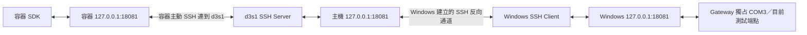

# 部署規格

> 核准更新（2026-11-03）：使用者已在本次對話接受全部建議答案，核准 Phase 0 文件與建議基線。下文「候選／建議／待核准」保留設計來源與理由，現已作為初始採用值；不代表硬體或網路已驗證。Q-11 接線與 UART 參數已由使用者確認；Q-12～Q-14、Q-17 的現場資訊仍待取得。目前實作與驗證進度以專案狀態文件為準。

## 日常自動認證（2026-11-07）

2026-11-13 起 Linux 預設採 [Go 獨立 Client](go-client.md)。Windows 開發端先執行 `./build-go-client.ps1` 建立 dist/uart-linux-amd64，發行時須隨附此檔，或明確設定 UART_GATEWAY_CLIENT_BINARY。Windows 的 Python Gateway／啟動器不變；Linux 目標只需要 x86_64、核心至少 3.2、既有 SSH 與 POSIX sh／coreutils，不需要 Python、Go、pip 或管理員安裝。CPU／核心須以現場 uname 確認；不同架構需另行建置。官方最低核心基準見 [Go Minimum Requirements](https://go.dev/wiki/MinimumRequirements)。

Linux 日常執行 `uart`，PATH 尚未包含 ~/.local/bin 時執行 `~/.local/bin/uart`。原 Python 管理的 v1 入口可由 Go v2 安全更新，固定角色不重新產生；其他同名入口拒絕覆蓋。重跑 Windows 選 2 可明確安裝到新主機。設定只保存一個目前目的地，三台不會同時建立三組 Tunnel；需切換目的地時重跑選 2。既有手動 SSH 連線與 Gateway 不會被接管。

2026-11-13 起可由 `run-uart.cmd` 的 R 進入下列管理流程；保留 `run-remote.cmd` 捷徑，Q／Ctrl+C 清理本次啟動的 Gateway／SSH。

2026-11-12 新增可選的 `run-remote.cmd`／`uart setup` 與 `uart gateway`，將下方原手動部署組合成互動流程。精靈安裝使用者私有、免 pip／虛擬環境的 Linux Client 與固定角色，日常由 Windows 建立本次 Gateway、SSH 反向轉送與 SDK 驗證。只支援直接 Linux 主機或已使用 host 網路的容器；不變更 Podman 網路、掛載、Shell 設定或防火牆。Windows 持久保存原憑證，容器重建後下一次明確啟動可重裝相同來源；不宣稱容器本身已有持久儲存。首次安裝與日常使用見 [認證流程](authentication.md)。原 CLI／手動 Tunnel 仍可單獨使用。

遠端可改採一次初始化的受保護憑證，由 SDK 自動載入；預設 read、明確 --access manage 選管理。步驟見 [認證初始化與 dxan 安裝](authentication.md)。Gateway 仍只綁 Loopback，SSH／Podman 路徑與 Host Key 驗證不變；不因已有 Tunnel 而略過應用層認證。初始化副本提供讀取／管理兩身分，原本機 S 臨時啟動保持獨立。

傳輸包只經受信任 SSH 標準輸入或受保護檔案安裝，不在聊天、argv 或一般設定放秘密；不自動配置遠端主機或容器。Container 的 SDK 來源屬其執行使用者，掛載或複製時須維持擁有者與保護，不能靠共享管理憑證當成 Agent 讀取隔離。這些新設定／ACL／初始化流程尚未在 Win11 或公司 SSH 實機驗證。

## 狀態與證據邊界

本文件保留完整候選部署設計，基線為 Windows 11 Gateway、d3s1 SSH Server（伺服器）與 Podman Container（容器），不得直接對公司網路開放 Gateway。目前現場 dxan 使用 host 網路，已由使用者驗證 Windows 反向轉送、遠端只讀 RX／重播及 Tunnel 中斷後手動恢復；不需要第二段 Container Local Forward（本地轉送）。以下雙段轉送圖是隔離網路的候選方案，不能當成 dxan 的實際路徑。

| 類別 | 已知內容 | 證據限制 |
| --- | --- | --- |
| 使用者提供的背景 | Linux Container 曾透過網路讀取 Windows COM3 | 未取得該程式、命令或 Log（紀錄），不代表本版本庫已實作或驗證 |
| 歷史起始檢查 | 初始版本庫只有文件工作前的空狀態 | 當時狀態；目前已有 Phase 1 程式，最新進度見專案狀態 |
| 已驗證現場 | dxan host 網路 → d3s1 Loopback → Windows 反向 SSH Tunnel → Gateway／COM3 | 使用者回報 RX、重播、中斷提示、Gateway 保持執行及重建後手動恢復成功；未量測零遺失 |
| 隔離網路候選 | Windows Loopback（回送介面）Gateway + Reverse Forward（反向轉送）+ Container Local Forward（本地轉送） | 完整雙段路徑尚未驗證；現場 host 模式僅需反向轉送 |
| 待驗證 | 其他 Podman Network Mode（網路模式）的 SSH／DNS 可達性、受限 Forward 政策、Adapter 唯一身分、USB 插拔及控制線量測 | 不能由目前 host 網路接收成功推論其他環境也已驗證 |

## 完整連線路徑



Windows SSH Client 主動連線到 d3s1，讓 d3s1 的反向接聽端能轉送到 Windows 本機 Gateway。Container SSH Client 再連到 d3s1 SSH Server，將容器內接聽端轉送到 d3s1 主機的反向接聽端。

三處 `127.0.0.1` 各自屬於 Windows、d3s1 Host（主機）與 Container 的 Network Namespace（網路命名空間）。Container 直接連自己的 `127.0.0.1` 不會到達 Host Listener（接聽端）。`host.containers.internal` 也不會自動讓只綁 Host Loopback 的服務對容器可達。

## 位址與 Port 規劃

| 位置 | 用途 | 候選位址 | 狀態 |
| --- | --- | --- | --- |
| Windows | Structured Protocol（結構化協定） | `127.0.0.1:18081` | Loopback 原則已確認；Port 尚待核准及衝突檢查 |
| d3s1 Host | Reverse Forward 接聽端 | `127.0.0.1:18081` | 待現場驗證 |
| Container | Local Forward 接聽端 | `127.0.0.1:18081` | 待網路與 SSH 權限驗證 |
| d3s1 Host | SSH Server | 現有 SSH 位址及 Port | 不假設一定是 22，不擅自變更 |
| Windows／Forward | 未來 Raw TCP（原始串流）相容介面 | 關閉；必要時從 18100 起明確配置 | 不屬候選 Phase 1 |

同號 Port 位於不同命名空間時不衝突。若已有服務占用，三段轉送位址必須一致調整；禁止悄悄改綁 `0.0.0.0` 解決連線問題。IPv6 不隱含開放，若使用 `::1` 需另核對整條路徑。

## 命令範例與前置條件

以下命令是語法有效的部署範例，使用保留的 `.invalid` 範例網域，尚未執行；必須先替換成經確認的 SSH 帳號、主機及 Port。不得照範例憑空認定 DNS 可用，也不得關閉 Host Key（主機金鑰）驗證。憑證與金鑰不寫入文件。

Windows PowerShell 的候選反向轉送：

```powershell
$UartSshUser = 'uart-tunnel'
$UartSshHost = 'd3s1.example.invalid'
$UartSshPort = 22
ssh -NT -p $UartSshPort -o ExitOnForwardFailure=yes -o ServerAliveInterval=15 -o ServerAliveCountMax=3 -R 127.0.0.1:18081:127.0.0.1:18081 "$UartSshUser@$UartSshHost"
```

Container 的 POSIX `/bin/sh` 候選本地轉送：

```sh
uart_ssh_user='uart-tunnel'
uart_ssh_host='d3s1.example.invalid'
uart_ssh_port='22'
ssh -NT -p "$uart_ssh_port" -o ExitOnForwardFailure=yes -o ServerAliveInterval=15 -o ServerAliveCountMax=3 -L 127.0.0.1:18081:127.0.0.1:18081 "$uart_ssh_user@$uart_ssh_host"
```

命令中的 Keepalive（連線存活檢查）數值為建議值。這兩條 SSH 連線可使用不同的最小權限帳號／金鑰；範例名稱不代表應共用憑證。

必須先確認 Container 能透過某個已知可達位址連到 d3s1 SSH Server。Rootless（非 root）或 Rootful（以 root 執行）Podman 的路由、Host Gateway（主機閘道）與 DNS 行為可能不同；本次不修改 Podman 設定。Host Networking（共用主機網路）可作另一部署方案，但隔離取捨尚未核准。

## COM Port 獨占與啟動順序

Windows Serial Backend（裝置存取實作）以平台支援的獨占方式開啟 COM；其他程式占用時回報 `PORT_BUSY`，不終止對方程式、不嘗試搶占。不能假設 pySerial 的各平台參數在 Windows 語意完全相同，需以實際開啟結果驗證。

Gateway 也要防止兩個 Channel（邏輯通道）解析到同一裝置。COM3 僅是第一個測試目標，重新插拔後依已確認的 Adapter（轉接器）條件辨識，模糊時停止。沒有唯一序號時不根據同名 COM 自動認定仍是原裝置。

候選啟動順序：確認線路與 DTR／RTS（控制線）→ Gateway 載入有效設定與認證資料 → 開啟允許的 RX → Windows 反向轉送 → Container 本地轉送 → SDK 協商與認證 → 使用者確認 Binding（綁定）→ 取得 TX Lease（傳送租約）。沒有 Gateway 程式前，不把以上步驟寫成現成啟動指令。

## 中斷與復原

- SSH Forward 建立失敗必須以非零退出及明確訊息呈現。`ExitOnForwardFailure` 不能保證後端 Gateway 永遠可達，仍需應用層握手檢查。
- Tunnel（通道）中斷時，Gateway 依 EOF 或應用層 Heartbeat（心跳）逾時清理 Session（工作階段），撤銷 Lease；不等待 SSH 長時間判斷才保護 TX。
- Gateway 的 UART RX 與已啟用的 Recorder（錄製器）不因 Client 斷線停止。Ring Buffer（環狀緩衝區）有限，錄製若未啟用或失敗，無法保證中斷期間資料仍在。
- 日後以 Windows 工作排程器或服務、Container 監督程序管理 SSH 的重建，採有上限的退避與抖動；本次不建立或選定部署腳本。
- SDK 重連後重新協商、認證與訂閱；依 Cursor（讀取位置）處理 Replay（重播）或 Gap（資料缺口），不得補送舊 TX 或自動恢復 Lease。
- Gateway Restart（重啟）產生新 Instance／Epoch；即使 Tunnel 還在，原 Session 與結果快取也不被視為存在。

## 防火牆、認證與授權

Windows 不為 Gateway 新增公司網路入站開放規則，只允許需要的 SSH 出站。d3s1 依既有安全政策提供 SSH，反向接聽端不公開。SSH Server 的 Forward 限制需依 OpenSSH 版本確認，可限制反向 Listen（接聽）位置、本地轉送目的地與帳號能力；不能未驗證就宣稱某組設定有效。

SSH 保護傳輸，但 Host／Container 上可接近 Loopback 的其他程序仍可能連線。Gateway 必須獨立 Authentication（認證），以 Principal（已認證身分）與 Channel ACL（存取規則）判斷 `read`、`tx`、`configure`。來源 IP、自報 Client ID 或 SSH 帳號不能直接代替應用層身分。

秘密使用檔案權限或受保護的 Secret（機密）注入；不得放在命令列、URL、版本庫或一般 Log。Raw TCP 若未來加入，必須另處理認證限制，不能因走 Tunnel 就允許任意寫入。若將來需要不經 SSH 的網路部署，須先提出 TLS／mTLS（雙向傳輸層認證）與相關新決策。

## 未來驗證清單

依序確認：Windows 只有預期 Loopback Listener → COM 開啟／占用錯誤 → d3s1 反向 Listener 位址 → Container 可連 SSH → 容器本地 Listener → Hello 與應用層認證 → RX 與受 Lease 保護的 TX → Tunnel 中斷清理 → 重連 Gap／Epoch 行為。

記錄 OS、OpenSSH、Podman、Python、Adapter／Driver 版本與實際命令。Win11 本機啟動與 RX 已由使用者執行確認；其餘路徑仍需逐項驗證，不能在 [專案狀態](status.md) 擴大標為 Verified（已實際驗證）。

## 本輪 Win11 接收驗證

pySerial Backend 與只讀 COM3 範例已建立，Linux 的真 pySerial PTY 與 CLI 驗證已通過。使用者確認僅接 TX／RX／GND，參數為 115200／8N1／無流控，並已在 Win11 啟動本 Gateway、以 uart.exe watch 收到 IPCAM 開機訊息。本機 RX 可依使用者實際執行的回報標為已驗證；這不同於初期 MobaXterm 接收成功的背景。

[Win11 本機接收步驟](windows-quickstart.md) 保留為重現流程，本機 RX 已成功，不需重做才能繼續。下一步確認既有 SSH 命令與轉送位置，建立 Container 到 Gateway 的只讀路徑；本次尚未修改 SSH／防火牆／Podman，也未驗證實體 TX。

後續遠端驗證已由使用者完成：`ssh victor.hu-vo@d3s1` 加上既有 Loopback 反向轉送，dxan 使用 host 網路直接連 `127.0.0.1:18081`。停止 Tunnel 時 CLI 顯示斷線、Gateway 無異動；重建後手動執行 CLI，可重新認證與重播。重現步驟見 [Container RX 測試](remote-rx-test.md)，實際進度以 [專案狀態](status.md) 為準。下一步是較長時間持續接收，不能把目前結果當作自動重連、持續錄製或零遺失證明。
