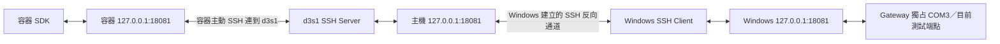

# 部署規格

> 核准更新（2026-11-03）：使用者已在本次對話接受全部建議答案，核准 Phase 0 文件與建議基線。下文「候選／建議／待核准」保留設計來源與理由，現已作為初始採用值；不代表硬體或網路已驗證。Q-11～Q-14、Q-17 的現場資訊仍待取得。Phase 1 尚未開始。

## 狀態與證據邊界

本文件為候選正式部署設計，不是已完成部署的操作紀錄。基線為 Windows 11 Gateway、d3s1 SSH Server（伺服器）與 Podman Container（容器），不得直接對公司網路開放 Gateway。

| 類別 | 已知內容 | 證據限制 |
| --- | --- | --- |
| 使用者提供的背景 | Linux Container 曾透過網路讀取 Windows COM3 | 未取得該程式、命令或 Log（紀錄），不代表本版本庫已實作或驗證 |
| 本次實際檢查 | 本機版本庫起始為 `work` 分支、尚無 commit（提交）及程式 | 僅證明本機狀態；文件建立後仍無實作 |
| 預計採用 | Windows Loopback（回送介面）Gateway + Reverse Forward（反向轉送）+ Container Local Forward（本地轉送） | 尚未執行任何部署命令 |
| 待驗證 | Podman Network Mode（網路模式）、SSH 位址、DNS、Forward 權限、防火牆、Port 衝突、Adapter 身分與控制線 | 需使用者資訊及未來獲授權的現場驗證 |

## 完整連線路徑



Windows SSH Client 主動連線到 d3s1，讓 d3s1 的反向接聽端能轉送到 Windows 本機 Gateway。Container SSH Client 再連到 d3s1 SSH Server，將容器內接聽端轉送到 d3s1 主機的反向接聽端。

三處 `127.0.0.1` 各自屬於 Windows、d3s1 Host（主機）與 Container 的 Network Namespace（網路命名空間）。Container 直接連自己的 `127.0.0.1` 不會到達 Host Listener（接聽端）。`host.containers.internal` 也不會自動讓只綁 Host Loopback 的服務對容器可達。

## 位址與 Port 規劃

| 位置 | 用途 | 候選位址 | 狀態 |
| --- | --- | --- | --- |
| Windows | Structured Protocol（結構化協定） | `127.0.0.1:18081` | Loopback 原則已確認；Port 尚待核准及衝突檢查 |
| d3s1 Host | Reverse Forward 接聽端 | `127.0.0.1:18081` | 待現場驗證 |
| Container | Local Forward 接聽端 | `127.0.0.1:18081` | 待網路與 SSH 權限驗證 |
| d3s1 Host | SSH Server | 現有 SSH 位址及 Port | 不假設一定是 22，不擅自變更 |
| Windows／Forward | 未來 Raw TCP（原始串流）相容介面 | 關閉；必要時從 18100 起明確配置 | 不屬候選 Phase 1 |

同號 Port 位於不同命名空間時不衝突。若已有服務占用，三段轉送位址必須一致調整；禁止悄悄改綁 `0.0.0.0` 解決連線問題。IPv6 不隱含開放，若使用 `::1` 需另核對整條路徑。

## 命令範例與前置條件

以下命令是語法有效的部署範例，使用保留的 `.invalid` 範例網域，尚未執行；必須先替換成經確認的 SSH 帳號、主機及 Port。不得照範例憑空認定 DNS 可用，也不得關閉 Host Key（主機金鑰）驗證。憑證與金鑰不寫入文件。

Windows PowerShell 的候選反向轉送：

```powershell
$UartSshUser = 'uart-tunnel'
$UartSshHost = 'd3s1.example.invalid'
$UartSshPort = 22
ssh -NT -p $UartSshPort -o ExitOnForwardFailure=yes -o ServerAliveInterval=15 -o ServerAliveCountMax=3 -R 127.0.0.1:18081:127.0.0.1:18081 "$UartSshUser@$UartSshHost"
```

Container 的 POSIX `/bin/sh` 候選本地轉送：

```sh
uart_ssh_user='uart-tunnel'
uart_ssh_host='d3s1.example.invalid'
uart_ssh_port='22'
ssh -NT -p "$uart_ssh_port" -o ExitOnForwardFailure=yes -o ServerAliveInterval=15 -o ServerAliveCountMax=3 -L 127.0.0.1:18081:127.0.0.1:18081 "$uart_ssh_user@$uart_ssh_host"
```

命令中的 Keepalive（連線存活檢查）數值為建議值。這兩條 SSH 連線可使用不同的最小權限帳號／金鑰；範例名稱不代表應共用憑證。

必須先確認 Container 能透過某個已知可達位址連到 d3s1 SSH Server。Rootless（非 root）或 Rootful（以 root 執行）Podman 的路由、Host Gateway（主機閘道）與 DNS 行為可能不同；本次不修改 Podman 設定。Host Networking（共用主機網路）可作另一部署方案，但隔離取捨尚未核准。

## COM Port 獨占與啟動順序

Windows Serial Backend（裝置存取實作）以平台支援的獨占方式開啟 COM；其他程式占用時回報 `PORT_BUSY`，不終止對方程式、不嘗試搶占。不能假設 pySerial 的各平台參數在 Windows 語意完全相同，需以實際開啟結果驗證。

Gateway 也要防止兩個 Channel（邏輯通道）解析到同一裝置。COM3 僅是第一個測試目標，重新插拔後依已確認的 Adapter（轉接器）條件辨識，模糊時停止。沒有唯一序號時不根據同名 COM 自動認定仍是原裝置。

候選啟動順序：確認線路與 DTR／RTS（控制線）→ Gateway 載入有效設定與認證資料 → 開啟允許的 RX → Windows 反向轉送 → Container 本地轉送 → SDK 協商與認證 → 使用者確認 Binding（綁定）→ 取得 TX Lease（傳送租約）。沒有 Gateway 程式前，不把以上步驟寫成現成啟動指令。

## 中斷與復原

- SSH Forward 建立失敗必須以非零退出及明確訊息呈現。`ExitOnForwardFailure` 不能保證後端 Gateway 永遠可達，仍需應用層握手檢查。
- Tunnel（通道）中斷時，Gateway 依 EOF 或應用層 Heartbeat（心跳）逾時清理 Session（工作階段），撤銷 Lease；不等待 SSH 長時間判斷才保護 TX。
- Gateway 的 UART RX 與已啟用的 Recorder（錄製器）不因 Client 斷線停止。Ring Buffer（環狀緩衝區）有限，錄製若未啟用或失敗，無法保證中斷期間資料仍在。
- 日後以 Windows 工作排程器或服務、Container 監督程序管理 SSH 的重建，採有上限的退避與抖動；本次不建立或選定部署腳本。
- SDK 重連後重新協商、認證與訂閱；依 Cursor（讀取位置）處理 Replay（重播）或 Gap（資料缺口），不得補送舊 TX 或自動恢復 Lease。
- Gateway Restart（重啟）產生新 Instance／Epoch；即使 Tunnel 還在，原 Session 與結果快取也不被視為存在。

## 防火牆、認證與授權

Windows 不為 Gateway 新增公司網路入站開放規則，只允許需要的 SSH 出站。d3s1 依既有安全政策提供 SSH，反向接聽端不公開。SSH Server 的 Forward 限制需依 OpenSSH 版本確認，可限制反向 Listen（接聽）位置、本地轉送目的地與帳號能力；不能未驗證就宣稱某組設定有效。

SSH 保護傳輸，但 Host／Container 上可接近 Loopback 的其他程序仍可能連線。Gateway 必須獨立 Authentication（認證），以 Principal（已認證身分）與 Channel ACL（存取規則）判斷 `read`、`tx`、`configure`。來源 IP、自報 Client ID 或 SSH 帳號不能直接代替應用層身分。

秘密使用檔案權限或受保護的 Secret（機密）注入；不得放在命令列、URL、版本庫或一般 Log。Raw TCP 若未來加入，必須另處理認證限制，不能因走 Tunnel 就允許任意寫入。若將來需要不經 SSH 的網路部署，須先提出 TLS／mTLS（雙向傳輸層認證）與相關新決策。

## 未來驗證清單

依序確認：Windows 只有預期 Loopback Listener → COM 開啟／占用錯誤 → d3s1 反向 Listener 位址 → Container 可連 SSH → 容器本地 Listener → Hello 與應用層認證 → RX 與受 Lease 保護的 TX → Tunnel 中斷清理 → 重連 Gap／Epoch 行為。

記錄 OS、OpenSSH、Podman、Python、Adapter／Driver 版本與實際命令。以上尚未執行，不能在 [專案狀態](status.md) 標為 Verified（已實際驗證）。
